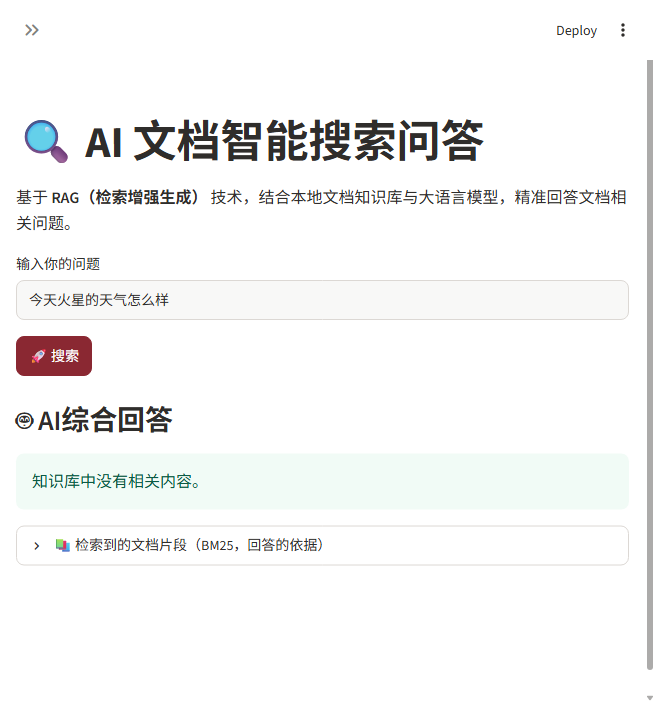

# 文档 RAG 问答系统（BM25）

面向小规模文档知识库的 RAG 问答原型：先把文档切成段落并建立 BM25 索引，再把检索到的原文片段连同来源和得分一起注入提示词，让大模型只依据证据回答。

这是一个个人项目原型，不是企业级知识库产品，也没有真实企业用户和线上流量。

## 运行截图

BM25 检索答案与来源展示：


无命中时的拒答：



## 项目定位

项目重点不是“换更大的模型”，而是处理 RAG 里的三个产品问题：

1. 用户的问题能不能找到对应资料；
2. 回答能不能展示来源，让用户核对依据；
3. 找不到依据时，系统是否敢明确说不知道。

## 当前实现

- 文档按空行切分为段落；
- 使用 jieba 做中文分词，过滤停用词和纯标点，保留有意义的单字；
- 使用 rank_bm25 的 BM25Okapi 建立内存索引；
- 检索 Top-5 片段，并对命中片段补充同源上一段和下一段；
- 将检索证据直接注入提示词，由 qwen-flash 组织答案；
- 界面展示命中片段、来源文件和 BM25 得分；
- 没有检索到内容时，提示“知识库中没有相关内容”。

当前知识库包含 14 篇文档、86 个段落，平均每段约 133.5 字。

## 技术栈

| 模块 | 技术 |
|---|---|
| 界面 | Streamlit |
| 检索 | rank_bm25 + jieba |
| 大模型 | 阿里云百炼 qwen-flash |
| Agent 框架 | qwen-agent（仅用于对话封装） |
| Elasticsearch 分支 | 已写检索代码与方案，但未部署验证 |
| 语言 | Python 3.11 |

## 处理链路

```text
本地 txt 文档
    ↓ 按空行切分
86 个段落
    ↓ jieba 分词、停用词过滤
BM25 内存索引
    ↓ 用户提问
Top-5 段落 + 同源相邻片段
    ↓ 证据注入提示词
qwen-flash 生成答案
    ↓
展示答案、来源文件、BM25 得分
```

## 已验证结果

核实日期：2026-11-17。

| 项目 | 结果 |
|---|---|
| 文档 / 段落 | 14 篇 / 86 段 |
| 索引构建 | 冷启动约 0.6—0.9 秒，含 jieba 首次加载；预热后约 30—50 毫秒 |
| 单次检索 | 完整工具调用约 0.45—1.7 毫秒，纯 BM25 打分约 0.04—0.06 毫秒 |
| 域内问题 | 4 个预设问题 Top-1 均命中 |
| 域外问题 | 无命中时提示“知识库中没有相关内容”；弱相关召回时由模型判断证据不足并拒答 |

4 个预设域内问题：

| 问题 | Top-1 来源 | BM25 得分 |
|---|---|---|
| BM25 的 k1 和 b 参数分别控制什么 | `02_BM25检索算法详解.txt` | 14.70 |
| PaddleOCR 识别模块用什么算法 | `12_自然场景OCR系统项目概览.txt` | 6.73 |
| Elasticsearch 索引建好了为什么搜不到 | `13_工程实践常见问题与排查.txt` | 13.23 |
| RAG 为什么缓解幻觉 | `06_大模型幻觉与RAG的边界.txt` | 8.80 |

这 4 个问题是预设演示问题，不是独立大规模测试集，不能据此宣称整体检索准确率。

## 快速开始

### 1. 创建环境

```powershell
cd 02_rag_doc_qa
py -3.11 -m venv .venv
.\.venv\Scripts\python.exe -m pip install -r requirements.txt
```

### 2. 配置 Key

复制 `.env.example` 为 `.env`，填入自己的百炼 Key：

```text
DASHSCOPE_API_KEY=sk-你的百炼Key
QWEN_MODEL=qwen-flash
QWEN_BASE_URL=https://dashscope.aliyuncs.com/compatible-mode/v1
```

`.env` 已被 `.gitignore` 排除，不要提交。

### 3. 启动

```powershell
.\.venv\Scripts\python.exe -m streamlit run final_app.py
```

浏览器打开 `http://localhost:8501`，默认进入 BM25 内存检索模式。

## 演示问题

1. BM25 的 k1 和 b 参数分别控制什么？
2. PaddleOCR 识别模块用什么算法？
3. Elasticsearch 索引建好了为什么搜不到？
4. RAG 为什么缓解幻觉？
5. 今天火星的天气怎么样？

前四个用于展示“答案 + 来源 + 得分”，第五个用于展示无命中时的拒答。

## 目录结构

```text
02_rag_doc_qa/
├── final_app.py          # Streamlit 主程序
├── kb_tool.py            # BM25KBTool：jieba 分词、索引、检索、邻接扩展
├── es_retrieval.py       # Elasticsearch 检索分支，仅代码与方案，未部署
├── docs/                 # 14 篇演示文档，共 86 个段落
├── images/               # 界面与旧版演示截图
├── requirements.txt
├── .env.example
└── README.md
```

## 边界与不足

- 这是小规模原型，知识库只有 14 篇文档、86 个段落。
- 当前检索层没有分数阈值，只过滤 `score > 0`，弱相关问题可能召回无关片段。
- 拒答依赖提示词和模型判断，不是确定性规则。
- BM25 对同义表达和多跳问题能力有限。
- 当前是内存索引，文档更新、并发和权限控制都未做企业级处理。
- Elasticsearch 分支没有部署，也没有实测性能，不应写成“双检索已落地”。
- 当前主链路是应用直接检索后注入提示词，不是模型通过 Function Calling 自动选择工具。

## 后续计划

1. 扩充域内、域外和相似文档干扰的评测问题；
2. 统计 Recall@K、MRR，并校准命中阈值；
3. 比较 BM25 与向量检索的混合召回效果；
4. 增加来源引用校验和失败案例分析。

## 说明

本项目用于 AI 产品经理实习求职的作品展示。所有指标均来自本地实际运行，未包装成企业线上产品。
